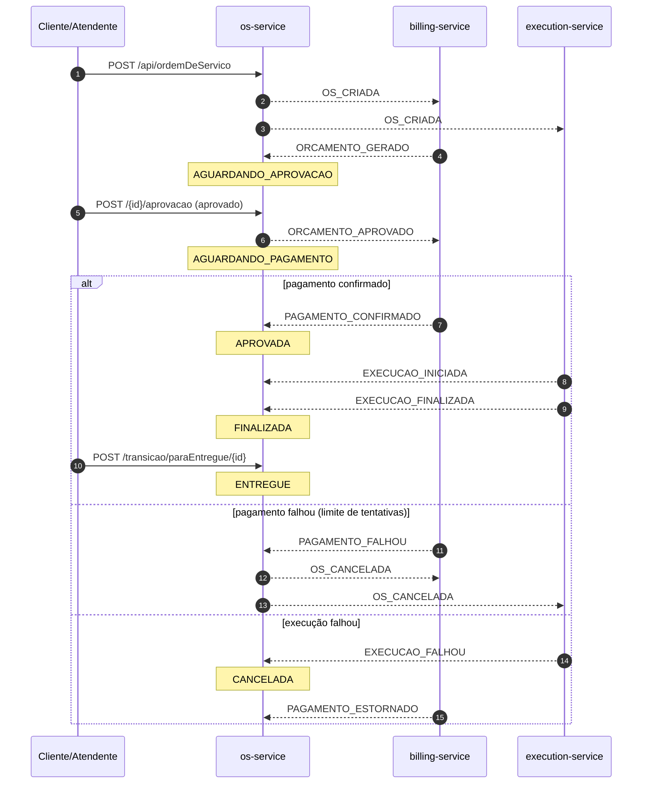
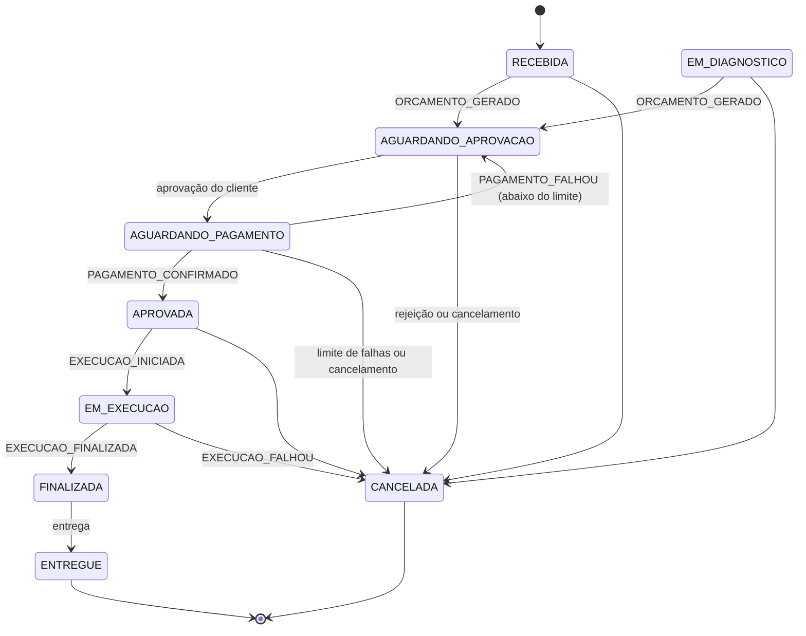

# tech-challenge-os-service

**os-service** do **Tech Challenge — Fase 4** (FIAP). É o serviço core da oficina mecânica: clientes, veículos, autenticação (JWT) e ordens de serviço (OS). Participa de uma **saga coreografada** com o billing-service e o execution-service, que são repositórios externos a este.

---

## Papel do os-service no sistema

| Serviço | Responsabilidade | Neste repositório? |
|---|---|---|
| **os-service** | OS, clientes, veículos, auth; dono do status da OS | sim |
| billing-service | Orçamento e pagamento (Mercado Pago) | não, externo |
| execution-service | Diagnóstico, estoque e execução | não, externo |

Os três se comunicam por eventos em **Amazon SNS** (tópicos) e **Amazon SQS** (filas). O os-service guarda o status da OS e reage aos eventos dos outros dois; não há chamada REST entre serviços.

Contrato completo dos eventos: [`docs/CONTRATO-EVENTOS.md`](docs/CONTRATO-EVENTOS.md).

---

## Tecnologias

- Java 21 (Amazon Corretto) e Spring Boot 4.0.5 (MVC, Data JPA, Security, Actuator)
- PostgreSQL 16 e Flyway (migrations V001 a V020, schema `os`)
- **Amazon SNS/SQS** com **Spring Cloud AWS 4.0.2**; **LocalStack 4.9** no desenvolvimento e nos testes
- JWT (JJWT), SpringDoc OpenAPI (Swagger UI)
- Micrometer/Prometheus e logs JSON (logstash) com `correlationId`
- Testes: JUnit 6, Mockito, Awaitility e **Cucumber** (BDD, em português); JaCoCo (mínimo 80%) e SonarQube
- Docker (multi-stage, `linux/amd64`), Kubernetes/Amazon EKS e GitHub Actions

---

## Arquitetura

Clean Architecture por módulo (`domain` → `usecase` → `adapter` → `framework`), em `app/src/main/java/com/fiap/techchallenge/os/`:

```
cliente/ veiculo/ usuario/     módulos de apoio (CRUD e auth)
ordemservico/
  domain/                      OrdemDeServico, StatusOrdemDeServico, máquina de estados
  usecase/                     OrdemDeServicoInteractor (abrir, consultar, aplicar eventos da saga)
  adapter/controller|gateway|messaging|presenter   REST, gateways e handlers dos eventos
  framework/persistence/       entidades e repositórios JPA
  observabilidade/             logs de eventos (chave-valor)
mensageria/
  contrato/                    envelope, tipos e payloads dos eventos
  usecase/                     PublicadorDeEventos, ManipuladorDeEvento
  adapter/                     outbox, relay para o SNS, consumidor SQS e despachante idempotente
  framework/                   propriedades e persistência (outbox_evento, evento_processado)
observabilidade/               filtro X-Correlation-Id e métricas da saga
security/ config/ exception/
```

### Por que Saga coreografada

- O fluxo é linear e tem **poucos participantes** (3). Cada serviço reage a um evento e publica o próximo, então um orquestrador seria um componente a mais sem ganho real.
- **Sem ponto central de falha:** se um serviço cai, os eventos esperam na fila e são processados quando ele volta. Não há orquestrador que, ao cair, pare todas as OS.
- **Baixo acoplamento:** os serviços só conhecem o contrato dos eventos, não as APIs uns dos outros. Compensações também são eventos (`PAGAMENTO_FALHOU`, `OS_CANCELADA`, `PAGAMENTO_ESTORNADO`).

**Trade-offs aceitos** e como foram mitigados:

| Trade-off | Mitigação |
|---|---|
| O fluxo fica espalhado entre serviços e é mais difícil de acompanhar | `correlationId = osId` nos eventos, logs e métricas, e o endpoint `GET /api/ordemDeServico/{id}/historico` |
| Publicar no broker e gravar no banco não são atômicos | **Outbox transacional:** o evento é gravado na mesma transação da OS e um relay o envia ao SNS |
| O SQS entrega "pelo menos uma vez" (duplicatas) | **Consumidores idempotentes:** `evento_processado` deduplica por `eventId` na mesma transação do handler |
| Mensagens que falham sempre | Reentrega pelo SQS e **DLQ** após 5 tentativas |
| Eventos fora de ordem ou inválidos para o estado atual | Máquina de estados rejeita a transição; o erro de negócio é confirmado e contado em `os.eventos.consumidos{resultado="erro_negocio"}` |

### Saga (sequência)



### Máquina de estados da OS



O número máximo de falhas de pagamento é `os.saga.pagamento.max-tentativas` (padrão 3).

---

## Eventos

| Evento | Tópico | Direção | Efeito no os-service |
|---|---|---|---|
| `OS_CRIADA` | `os-events` | publicado | Ao abrir a OS |
| `ORCAMENTO_APROVADO` | `os-events` | publicado | Ao aprovar o orçamento |
| `ORCAMENTO_REJEITADO` | `os-events` | publicado | Ao rejeitar o orçamento (OS cancelada) |
| `OS_CANCELADA` | `os-events` | publicado | Cancelamento manual ou pagamento recusado no limite |
| `ORCAMENTO_GERADO` | `billing-events` | consumido | Grava `orcamentoId` e `valorTotal`; vai a AGUARDANDO_APROVACAO |
| `PAGAMENTO_CONFIRMADO` | `billing-events` | consumido | Vai a APROVADA |
| `PAGAMENTO_FALHOU` | `billing-events` | consumido | Volta a AGUARDANDO_APROVACAO ou cancela no limite |
| `PAGAMENTO_ESTORNADO` | `billing-events` | consumido | Só registra |
| `DIAGNOSTICO_CONCLUIDO`, `ESTOQUE_RESERVADO` | `execution-events` | consumido | Só registra |
| `EXECUCAO_INICIADA` | `execution-events` | consumido | Vai a EM_EXECUCAO |
| `EXECUCAO_FINALIZADA` | `execution-events` | consumido | Vai a FINALIZADA |
| `EXECUCAO_FALHOU` | `execution-events` | consumido | Cancela a OS |

---

## Endpoints

Rotas de negócio exigem `Authorization: Bearer <JWT>` (perfis ATENDENTE e GERENTE), exceto as marcadas com **webhook**, que exigem o header `X-Webhook-Secret`.

| Método | Rota | Descrição |
|---|---|---|
| POST | `/api/auth/login` | Login; retorna o JWT |
| POST | `/api/auth/usuario` | Cria usuário (GERENTE) |
| GET/POST | `/api/cliente` | Lista (filtro `documento`) / cria |
| GET/PUT/DELETE | `/api/cliente/{id}` | Consulta / atualiza / remove |
| GET/POST | `/api/veiculo` | Lista (filtro `placa`) / cria |
| GET/PUT/DELETE | `/api/veiculo/{id}` | Consulta / atualiza / remove |
| PUT/DELETE | `/api/veiculo?placa=` | Atualiza / remove por placa |
| GET | `/api/ordemDeServico` | Lista OS |
| POST | `/api/ordemDeServico` | Abre a OS e publica `OS_CRIADA` |
| GET | `/api/ordemDeServico/{id}` | Consulta a OS |
| GET | `/api/ordemDeServico/{id}/historico` | Linha do tempo: status, eventos publicados e recebidos |
| GET | `/api/ordemDeServico/cliente/{id}/ordens` | OS do cliente |
| GET | `/api/ordemDeServico/veiculo/{id}/ordens` | OS do veículo |
| PUT/DELETE | `/api/ordemDeServico/{id}` | Atualiza / remove |
| POST | `/api/ordemDeServico/{id}/aprovacao` | **webhook:** aprova ou rejeita o orçamento |
| POST | `/api/ordemDeServico/{id}/cancelar` | Cancela a OS (`motivo` obrigatório) |
| POST | `/api/ordemDeServico/transicao/paraEntregue/{id}` | **webhook:** registra a entrega |

Orçamento, pagamento e execução não têm endpoint REST: avançam por eventos.

---

## Execução local

Pré-requisito: Docker (e JDK 21 para rodar fora do contêiner).

```bash
docker compose up --build -d
```

Sobe o PostgreSQL, o **LocalStack** (tópicos, filas e DLQs criados por `localstack/init/ready.d/01-criar-recursos.sh`) e a aplicação em `http://localhost:8080`.

- Swagger UI: `http://localhost:8080/swagger-ui/index.html`
- Health: `http://localhost:8080/actuator/health`
- Métricas: `http://localhost:8080/actuator/prometheus`
- Login de exemplo: `gerente` / `senha@123` (também `atendente` e `mecanico`)

Para simular o billing e o execution localmente, publique no LocalStack:

```bash
docker exec tech_challenge_localstack awslocal sns publish \
  --topic-arn arn:aws:sns:us-east-1:000000000000:billing-events \
  --message '{"eventId":"11111111-1111-1111-1111-111111111111","type":"ORCAMENTO_GERADO","version":1,"occurredAt":"2026-01-01T10:00:00Z","correlationId":"1","payload":{"osId":"1","orcamentoId":"orc-1","valorTotal":350.5}}'
```

Para rodar a aplicação pelo Gradle (hot reload), suba só a infraestrutura com `docker compose up -d db localstack` e execute `./gradlew bootRun`.

Para parar: `docker compose down`.

### Variáveis de ambiente

| Variável | Padrão | Descrição |
|---|---|---|
| `SPRING_DATASOURCE_URL`, `_USERNAME`, `_PASSWORD` | PostgreSQL local | Banco de dados |
| `JWT_SECRET`, `JWT_ACCESS_EXP` | chave de dev, `3600` | Assinatura e validade do JWT |
| `WEBHOOK_APROVACAO_SECRET` | `webhook-secret-key-123` | Valor esperado em `X-Webhook-Secret` |
| `AWS_REGION` | `us-east-1` | Região do SNS/SQS |
| `OS_TOPICO_OS_EVENTS`, `OS_TOPICO_BILLING_EVENTS`, `OS_TOPICO_EXECUTION_EVENTS` | nomes dos tópicos | Nome ou ARN |
| `OS_FILA_BILLING`, `OS_FILA_EXECUTION` | nomes das filas | Nome ou URL |
| `OS_SAGA_PAGAMENTO_MAX_TENTATIVAS` | `3` | Falhas de pagamento até cancelar a OS |
| `OS_OUTBOX_RELAY_*` | 1 s, lote 50, 5 tentativas | Intervalo, lote e tentativas do relay |

As credenciais de teste do LocalStack (`test`/`test`) existem só no `docker-compose.yml`.

---

## Testes, BDD e cobertura

```bash
./gradlew :app:check
```

O `check` roda os testes unitários e de integração, o BDD e a verificação de cobertura. Os testes sobem Postgres e LocalStack sozinhos pelo `app/src/test/resources/docker-compose-test.yaml`, então o Docker precisa estar ativo.

- **BDD (Cucumber, em português):** `app/src/test/resources/features/`: `saga_fluxo_feliz`, `saga_pagamento_recusado` e `saga_execucao_falhou`. O billing e o execution são simulados publicando no SNS do LocalStack.
- **Cobertura:** relatório em `app/build/reports/jacoco/test/html/index.html`. A build falha abaixo de 80% de instruções. Ficam fora da cobertura apenas classes sem lógica (aplicação, configs, propriedades, entidades e DTOs), e as mesmas exclusões valem no Sonar.
- **SonarQube local:**

```bash
docker compose --profile tools up -d sonarqube
./gradlew :app:check :app:sonar -Dsonar.token=<TOKEN>
```

---

## CI/CD e deploy

| Workflow | Disparo | O que faz |
|---|---|---|
| `.github/workflows/pr.yml` | Pull Request para `main` | `Testes e Cobertura (JaCoCo)`, `SonarQube Quality Gate` (falha o PR se o quality gate falhar) e `Validar Build da Imagem Docker` |
| `.github/workflows/deploy.yml` | Push na `main` ou manual | Roda os testes, publica a imagem `os-service` no ECR e aplica `k8s/` no EKS |

- **Proteção da `main`:** [`docs/PROTECAO-BRANCH.md`](docs/PROTECAO-BRANCH.md).
- **Kubernetes** (`k8s/`): Deployment, Service (NLB), HPA, PDB, ConfigMap `os-service-config`, Secret `os-service-secrets` (criado pelo `deploy.yml`) e `serviceaccount.yaml` com a annotation de IRSA. No AWS Academy (LabRole, sem IRSA), as credenciais vêm da role do nó.
- **Mensageria na AWS:** `infra/aws/criar-recursos-mensageria.sh` (idempotente) cria tópicos, filas, DLQs, assinaturas e a policy das filas. `infra/aws/politica-iam-os-service.json` traz as permissões mínimas do serviço.
- **Secrets do repositório:** `AWS_ACCESS_KEY_ID`, `AWS_SECRET_ACCESS_KEY`, `AWS_SESSION_TOKEN`, `DB_URL`, `DB_USER`, `DB_PASSWORD`, `JWT_SECRET`, `WEBHOOK_APROVACAO_SECRET`, `SONAR_TOKEN` e `SONAR_HOST_URL`.
- **Imagem:** `docker build --platform linux/amd64 -t os-service:local -f app/Dockerfile .` (os nós do EKS são x86_64).

---

## Observabilidade

- Logs JSON com `correlationId` (o osId nas rotas de OS; o header `X-Correlation-Id` ou um UUID nas demais), `eventId` e `eventType` nos logs de mensageria.
- Métricas em `/actuator/prometheus`: `os_eventos_publicados_total{tipo}`, `os_eventos_consumidos_total{tipo,resultado}`, `os_outbox_pendentes` e `os_saga_transicoes_total{de,para}`.

---

## Documentação e entregáveis

- Swagger/OpenAPI: `/swagger-ui/index.html` e `/v3/api-docs`
- **Postman:** `postman/Tech Challenge Fase 4 - OS Service.postman_collection.json` e `postman/TechChallenge-Fase4.postman_environment.json`. Rode **Login** primeiro; o token e o id da OS são gravados nas variáveis.
- Contrato de eventos: [`docs/CONTRATO-EVENTOS.md`](docs/CONTRATO-EVENTOS.md)
- Checklist dos entregáveis: [`docs/EVIDENCIAS.md`](docs/EVIDENCIAS.md)
